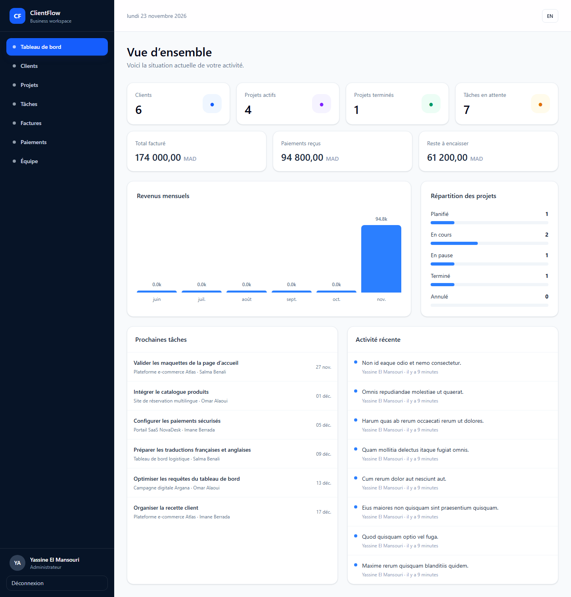
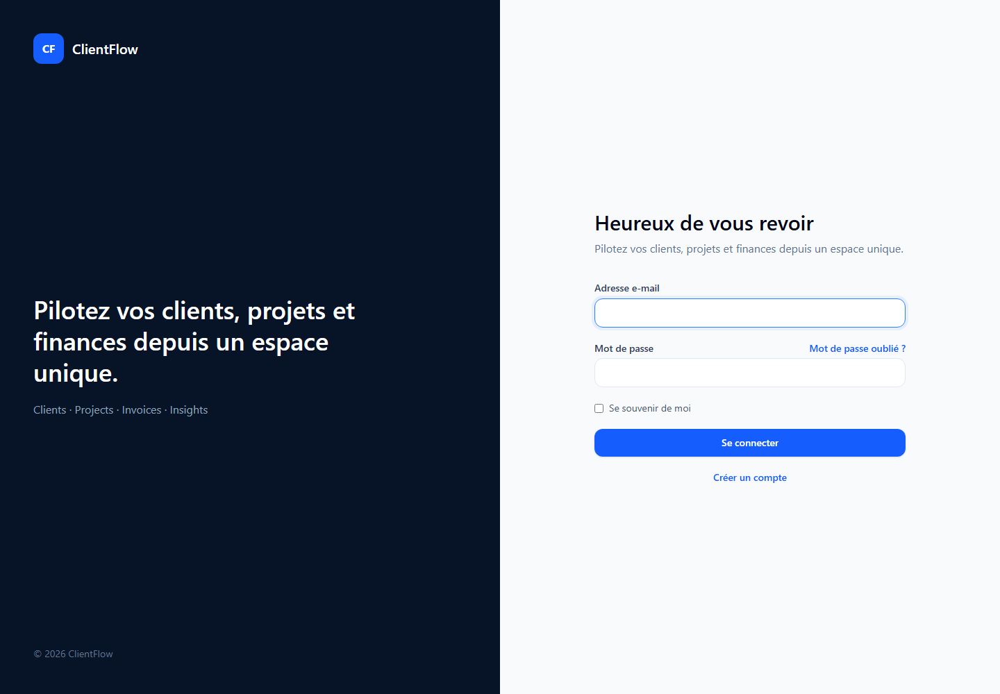
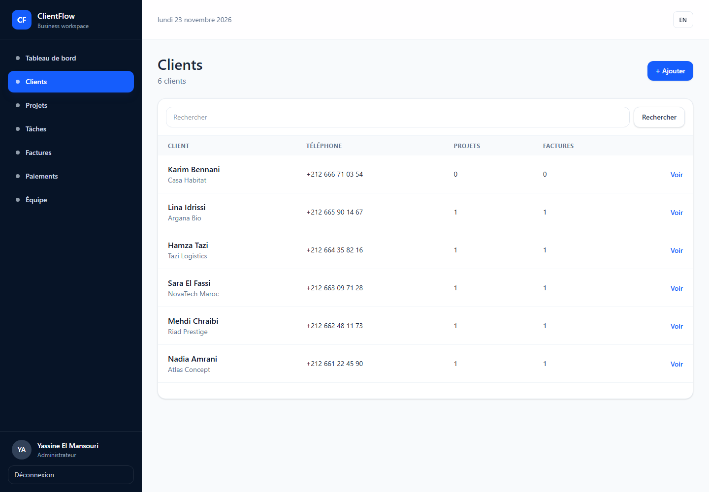
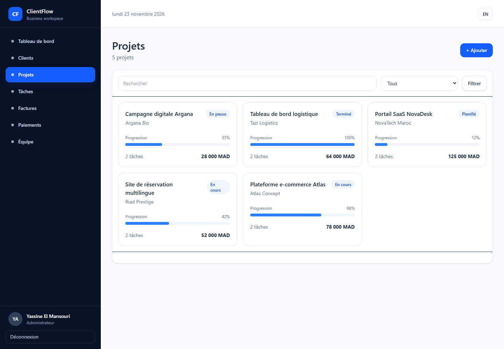
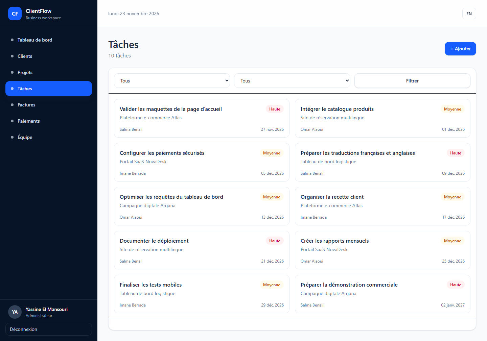
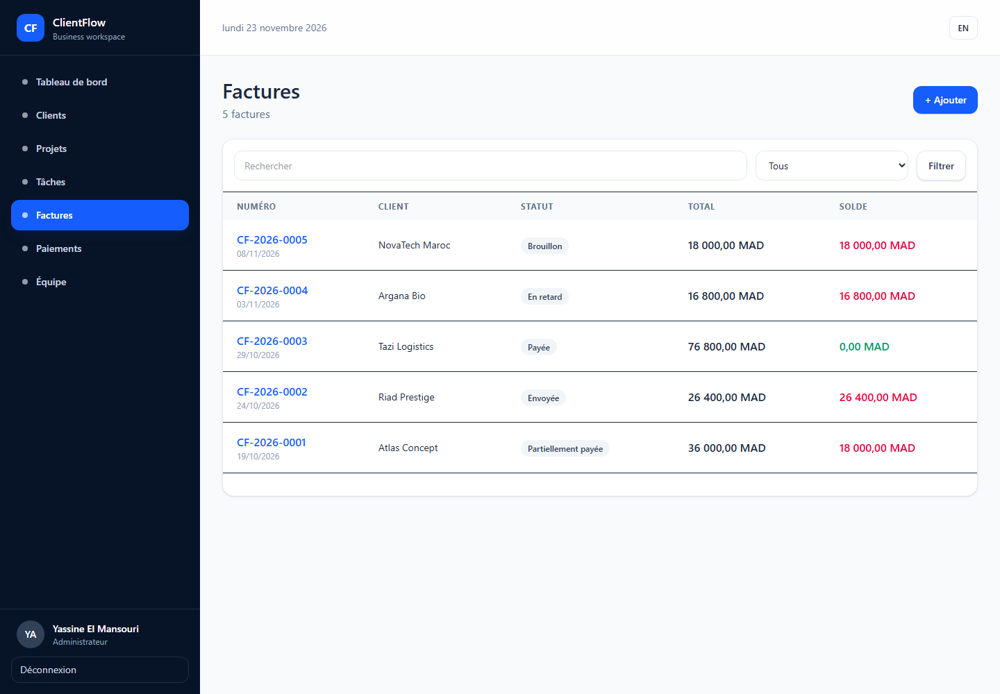
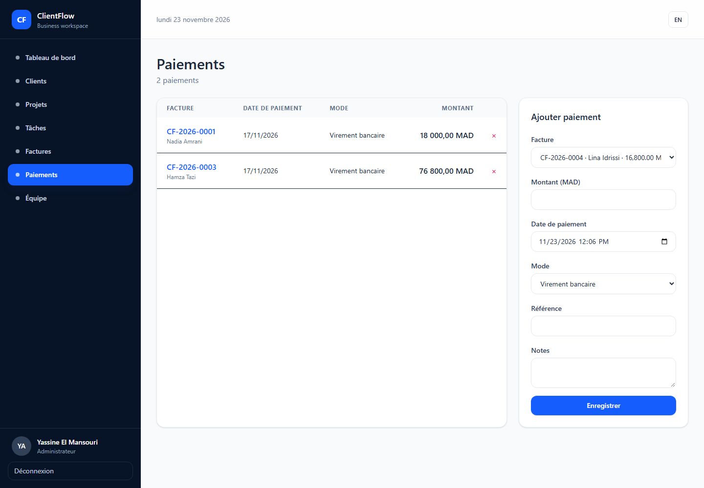
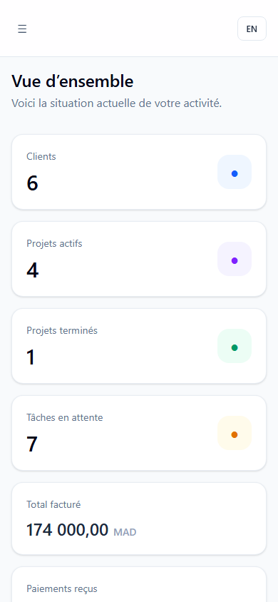

# ClientFlow

[Read in English](README.md)

ClientFlow est une application bilingue de gestion des clients, projets, tâches, factures et paiements destinée aux freelances, agences et entreprises de services. Elle a été conçue comme un projet de portfolio Laravel orienté production, avec des autorisations sécurisées, des données professionnelles marocaines, une interface responsive et des statistiques issues de la base de données.



## Objectif

ClientFlow centralise le suivi commercial, la réalisation des projets et la gestion financière dans un espace unique. Les administrateurs pilotent l'ensemble de l'activité, tandis que les employés disposent d'un accès limité à leur travail assigné. Le français est la langue par défaut, l'anglais est disponible dans l'interface et les montants sont exprimés en dirhams marocains (MAD).

## Fonctionnalités

- Inscription, connexion, déconnexion et réinitialisation du mot de passe sécurisées, avec renouvellement de session, protection CSRF et limitation des tentatives.
- Rôles `ADMIN` et `EMPLOYEE` appliqués côté serveur par middleware et contrôles d'autorisation.
- Tableau de bord alimenté par la base de données : clients, projets, tâches, facturation, encaissements, soldes, revenus mensuels et statuts des projets.
- Répertoire clients avec recherche et opérations complètes de création, consultation, modification et suppression.
- Projets avec budgets, échéances, progression, statuts, client associé et collaborateurs assignés.
- Tâches assignées avec priorités, dates limites, suivi d'achèvement et accès limité par employé.
- Factures liées aux clients et projets, avec plusieurs lignes, calcul de TVA, montants en MAD, statuts et téléchargement PDF.
- Enregistrement transactionnel des paiements, historique, mise à jour automatique du statut et prévention des trop-perçus.
- Gestion des comptes employés, rôles et activation par les administrateurs.
- Localisation française et anglaise pour l'authentification, la navigation, le tableau de bord et les écrans métier.
- Interface responsive avec Tailwind CSS et Alpine.js : navigation mobile, filtres, pagination, validation, états vides et notifications.
- Jeu de données marocain réaliste pour le développement et la démonstration.

## Captures d'écran

### Authentification



### Clients



### Projets



### Tâches



### Factures



### Paiements



### Mobile



## Technologies

- PHP 8.3+ et Laravel 13
- Eloquent ORM, compatible MySQL et SQLite pour le développement local
- Templates Blade, Tailwind CSS 4, Alpine.js et Vite 8
- DOMPDF pour les factures téléchargeables
- PHPUnit 12 pour les tests fonctionnels et métier
- Playwright avec Chromium pour les tests navigateur et captures d'écran
- Composer, npm et Git

## Prérequis

- PHP 8.3 ou supérieur avec `pdo_mysql` ou `pdo_sqlite`, `mbstring`, `openssl`, `fileinfo`, `dom` et `zip`
- Composer 2
- Node.js 20.19+ et npm
- MySQL 8+ pour un environnement proche de la production, ou SQLite en local

## Installation

```bash
git clone https://github.com/yasser-dev-code/ClientFlow.git
cd ClientFlow
composer install
npm install
cp .env.example .env
php artisan key:generate
```

Sous Windows PowerShell :

```powershell
Copy-Item .env.example .env
```

Générer un mot de passe unique d'au moins 20 caractères avec un gestionnaire de mots de passe, puis le conserver uniquement dans le fichier `.env` local :

```dotenv
DEMO_ADMIN_PASSWORD=
```

Renseigner cette entrée localement avant d'exécuter les seeders. Ne jamais versionner, journaliser ou afficher sa valeur dans une capture d'écran. Le seeder de démonstration échoue de façon sûre si la variable est vide et ne s'exécute que lorsque `APP_ENV` vaut `local` ou `testing`.

### Configuration SQLite

Conserver `DB_CONNECTION=sqlite` dans `.env`, puis créer la base locale :

```powershell
New-Item -ItemType File database/database.sqlite -Force
```

Sous macOS ou Linux :

```bash
touch database/database.sqlite
```

### Configuration MySQL

Créer une base vide, puis renseigner `.env` sans versionner les identifiants :

```dotenv
DB_CONNECTION=mysql
DB_HOST=127.0.0.1
DB_PORT=3306
DB_DATABASE=clientflow
DB_USERNAME=utilisateur_local
DB_PASSWORD=mot_de_passe_local
```

Exécuter les migrations, les seeders et la compilation :

```bash
php artisan migrate --seed
npm run build
```

Démarrer l'application :

```bash
composer run dev
```

Il est également possible d'utiliser `php artisan serve` et `npm run dev` dans deux terminaux.

## Identifiants de démonstration

Ces comptes sont créés uniquement dans les environnements local ou de test. Ils partagent le `DEMO_ADMIN_PASSWORD` configuré localement ; ne jamais réutiliser ce mot de passe ailleurs ni en production.

| Rôle | E-mail | Mot de passe |
| --- | --- | --- |
| Administrateur | `admin@clientflow.ma` | Valeur locale de `DEMO_ADMIN_PASSWORD` |
| Employé | `salma@clientflow.ma` | Valeur locale de `DEMO_ADMIN_PASSWORD` |

## Tests

Réinitialiser et remplir la base locale avant les tests navigateur :

```bash
php artisan migrate:fresh --seed
php artisan test --compact
npm run test:browser
npm run build
composer audit
npm audit
```

La configuration Playwright démarre automatiquement le serveur Laravel et utilise son propre Chromium. Les scénarios couvrent l'authentification, les principaux modules, la gestion des employés, le changement de langue et la navigation mobile.

## Structure du projet

```text
app/
  Http/Controllers/       Authentification et flux des ressources
  Http/Middleware/        Comptes actifs, administration et langue
  Http/Requests/          Validation et autorisation
  Models/                 Modèles Eloquent et relations
database/
  factories/              Données de test
  migrations/             Schéma, contraintes et index
  seeders/                Jeu de données marocain
lang/en, lang/fr/         Traductions anglaises et françaises
resources/
  css, js/                Entrées Tailwind et Alpine
  views/                  Layouts Blade et écrans métier
tests/
  Feature/                Tests PHPUnit
  Browser/                Tests de bout en bout Playwright
docs/screenshots/         Captures réelles de l'application
```

## Sécurité

- Les mots de passe sont hachés par Laravel.
- Les mots de passe de démonstration proviennent de l'environnement local non versionné et les données de démonstration sont bloquées hors des environnements local et de test.
- Les formulaires de modification utilisent la protection CSRF.
- Les routes d'authentification sont limitées en fréquence.
- Les rôles et comptes actifs sont contrôlés côté serveur.
- Les Form Requests valident les entrées et les modèles limitent l'assignation de masse.
- Blade échappe les contenus fournis par les utilisateurs.
- Eloquent utilise des paramètres liés pour les requêtes SQL.
- Les paiements utilisent une transaction et un verrou de ligne afin d'empêcher un dépassement concurrent du solde.
- `.env`, les bases locales, dépendances, journaux, caches, rapports navigateur et identifiants privés sont exclus de Git.

En production, il faut utiliser `APP_ENV=production`, désactiver le mode debug, définir des secrets uniques, configurer un vrai transport e-mail, imposer HTTPS et exécuter les files d'attente avec un gestionnaire de processus.

## Améliorations futures

- Envoi d'e-mails et rappels de factures
- Portail client et pièces jointes
- Factures récurrentes et taxes configurables
- API REST et intégrations webhook
- Exports de rapports et historique d'audit enrichi

## Auteur

Créé par [yasser-dev-code](https://github.com/yasser-dev-code) comme projet de portfolio full-stack.

## Licence

Ce projet est disponible sous [licence MIT](https://opensource.org/licenses/MIT).
