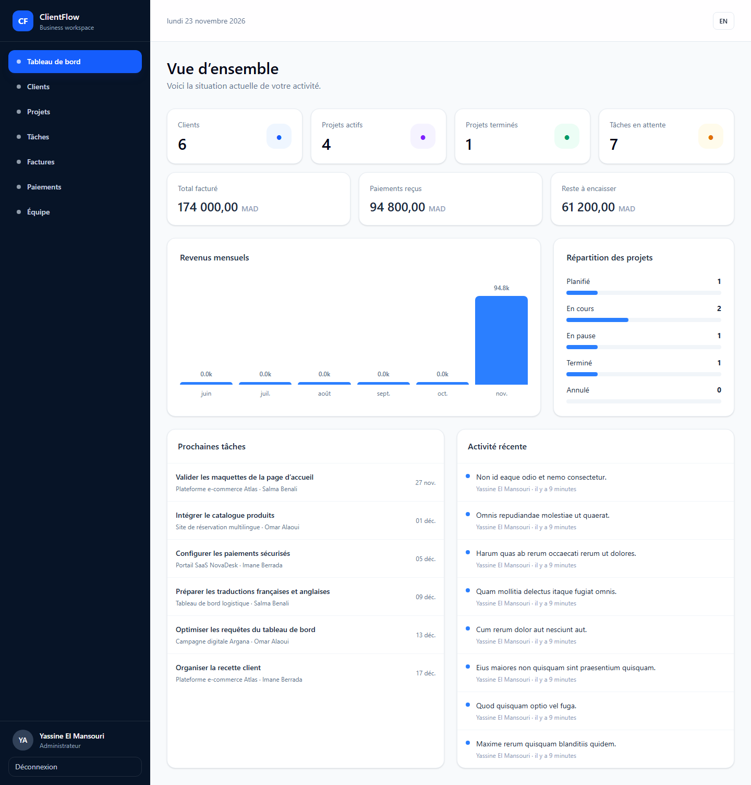
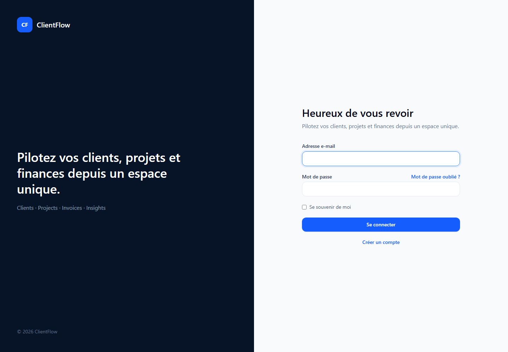
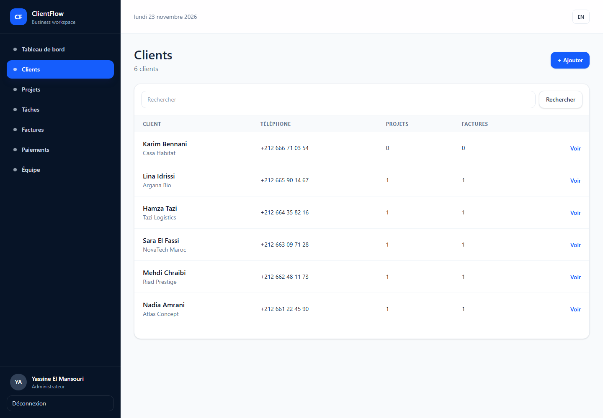
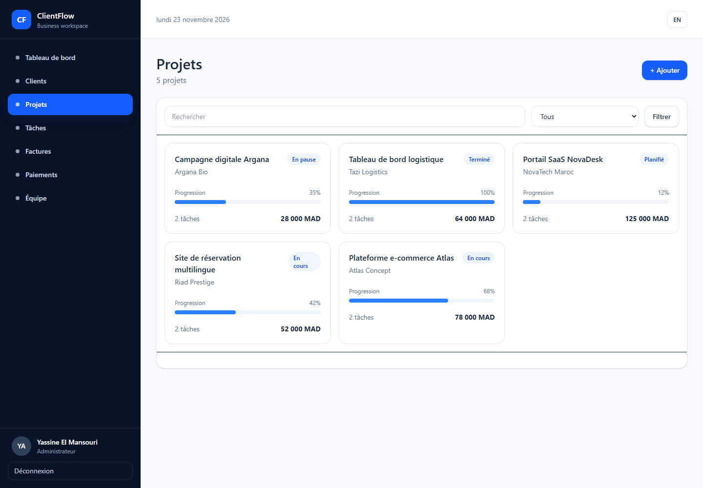
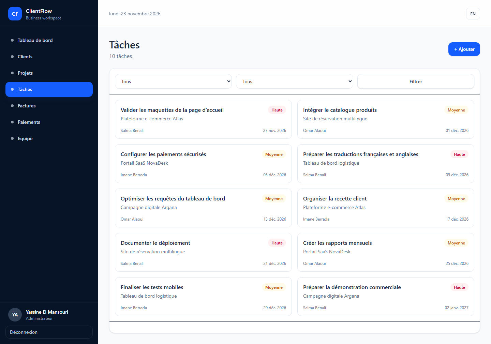
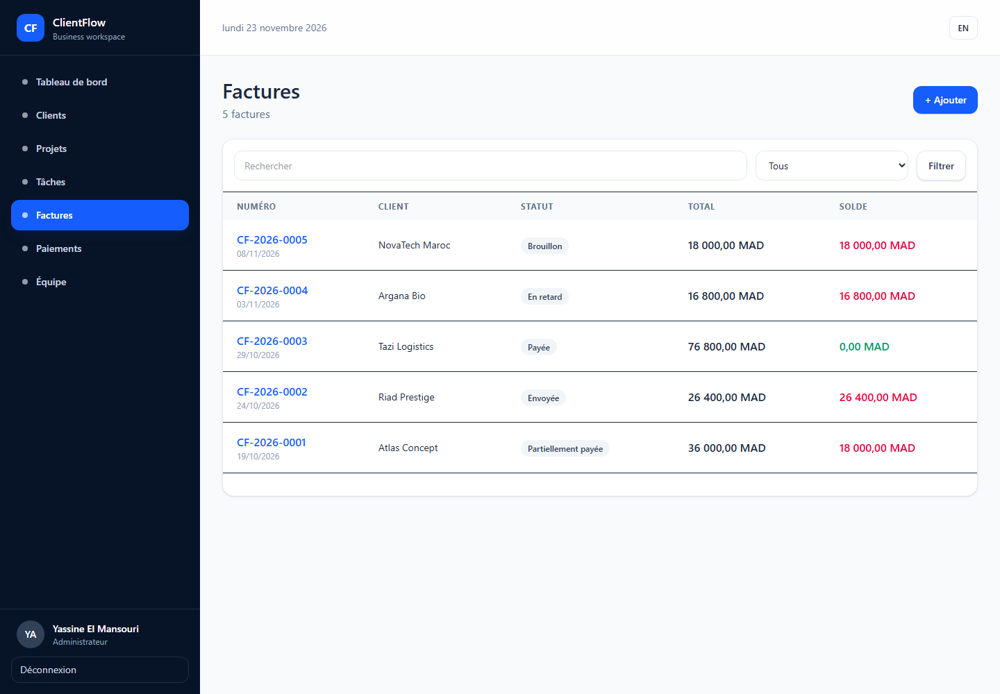
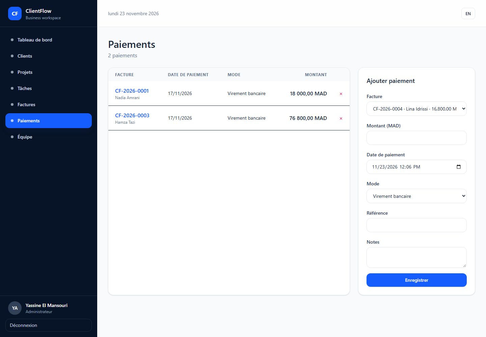
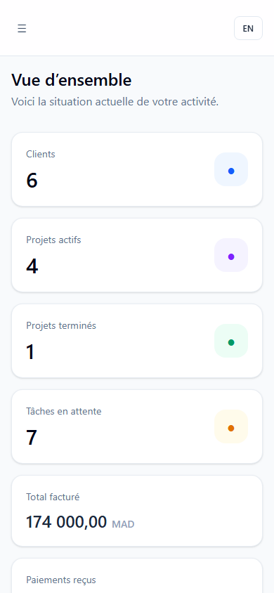

# ClientFlow

[Lire en français](README.fr.md)

ClientFlow is a bilingual client, project, task, invoice, and payment management application for freelancers, agencies, and service businesses. It was built as a production-oriented Laravel portfolio project with secure role-based access, realistic Moroccan business data, responsive workflows, and database-backed reporting.



## Purpose

ClientFlow brings commercial and delivery operations into one focused workspace. Administrators can manage the full business lifecycle, while employees receive restricted access to assigned work. French is the default language, English is available from the interface, and financial values use Moroccan dirhams (MAD).

## Features

- Secure registration, login, logout, password reset, session regeneration, CSRF protection, and rate limiting.
- `ADMIN` and `EMPLOYEE` roles enforced by backend middleware and authorization checks.
- Database-backed dashboard with client, project, task, invoicing, payment, outstanding-balance, monthly-revenue, and project-status statistics.
- Searchable client directory with complete create, read, update, and delete workflows.
- Project budgets, deadlines, progress, statuses, client relationships, and employee assignments.
- Assigned tasks with priorities, deadlines, completion tracking, and employee-specific access.
- Invoices linked to clients and projects with multiple line items, tax calculation, MAD totals, statuses, and downloadable PDF files.
- Transaction-safe payment recording, payment history, automatic invoice status updates, and overpayment prevention.
- Administrator-managed employee accounts, roles, and account activation.
- French and English localization across authentication, navigation, dashboard, and management screens.
- Responsive Tailwind CSS and Alpine.js interface with mobile navigation, filters, pagination, validation feedback, empty states, and notifications.
- Realistic seeded Moroccan clients, businesses, projects, tasks, invoices, and payments.

## Screenshots

### Authentication



### Clients



### Projects



### Tasks



### Invoices



### Payments



### Mobile



## Technology

- PHP 8.3+ and Laravel 13
- Eloquent ORM with MySQL support and SQLite for convenient local development
- Blade templates, Tailwind CSS 4, Alpine.js, and Vite 8
- DOMPDF for downloadable invoices
- PHPUnit 12 for feature and domain tests
- Playwright with Chromium for end-to-end browser testing and screenshots
- Composer, npm, and Git

## Requirements

- PHP 8.3 or later with `pdo_mysql` or `pdo_sqlite`, `mbstring`, `openssl`, `fileinfo`, `dom`, and `zip`
- Composer 2
- Node.js 20.19+ and npm
- MySQL 8+ for a production-style environment, or SQLite for local development

## Installation

```bash
git clone https://github.com/yasser-dev-code/ClientFlow.git
cd ClientFlow
composer install
npm install
cp .env.example .env
php artisan key:generate
```

On Windows PowerShell, copy the environment file with:

```powershell
Copy-Item .env.example .env
```

### SQLite setup

Keep `DB_CONNECTION=sqlite` in `.env`, then create the local database:

```powershell
New-Item -ItemType File database/database.sqlite -Force
```

On macOS or Linux:

```bash
touch database/database.sqlite
```

### MySQL setup

Create an empty database, then configure `.env` without committing credentials:

```dotenv
DB_CONNECTION=mysql
DB_HOST=127.0.0.1
DB_PORT=3306
DB_DATABASE=clientflow
DB_USERNAME=your_local_user
DB_PASSWORD=your_local_password
```

Run migrations and seed the development dataset:

```bash
php artisan migrate --seed
npm run build
```

Start the application:

```bash
composer run dev
```

Alternatively, use `php artisan serve` and `npm run dev` in separate terminals.

## Development demo credentials

These accounts are created only by the development seeder and must never be reused in production.

| Role | Email | Password |
| --- | --- | --- |
| Administrator | `admin@clientflow.ma` | `ClientFlow2026!` |
| Employee | `salma@clientflow.ma` | `ClientFlow2026!` |

## Testing

Reset and seed the local database before browser tests:

```bash
php artisan migrate:fresh --seed
php artisan test --compact
npm run test:browser
npm run build
composer audit
npm audit
```

The Playwright configuration starts the Laravel development server automatically and uses its bundled Chromium. Browser tests cover authentication, core management areas, employee management, language switching, and mobile navigation.

## Project structure

```text
app/
  Http/Controllers/       Authentication and resource workflows
  Http/Middleware/        Active-account, administrator, and locale boundaries
  Http/Requests/          Validation and authorization rules
  Models/                 Eloquent domain models and relationships
database/
  factories/              Test data factories
  migrations/             Relational schema, constraints, and indexes
  seeders/                Moroccan development dataset
lang/en, lang/fr/         English and French translations
resources/
  css, js/                Tailwind and Alpine entry points
  views/                  Blade layouts and feature screens
tests/
  Feature/                PHPUnit application tests
  Browser/                Playwright end-to-end tests
docs/screenshots/         Real application screenshots
```

## Security

- Passwords are hashed through Laravel's password cast.
- State-changing forms use CSRF protection.
- Authentication endpoints are rate-limited.
- Role and active-account restrictions are enforced on the server.
- Form Requests validate accepted input and models restrict mass assignment.
- Blade escapes user-provided content by default.
- Eloquent parameter binding protects database queries.
- Payment creation uses a database transaction and row lock to prevent concurrent overpayment.
- `.env`, local databases, dependencies, logs, caches, browser reports, and private credentials are excluded from Git.

Production deployments should set `APP_ENV=production`, disable debug mode, use unique credentials and secrets, configure a real mail transport, enforce HTTPS, and run queues under a process manager.

## Future improvements

- Email delivery and invoice reminders
- Client-facing portal and file attachments
- Recurring invoices and configurable taxes
- REST API and webhook integrations
- Expanded reporting exports and audit history

## Author

Created by [yasser-dev-code](https://github.com/yasser-dev-code) as a full-stack portfolio project.

## License

This project is available under the [MIT License](https://opensource.org/licenses/MIT).
